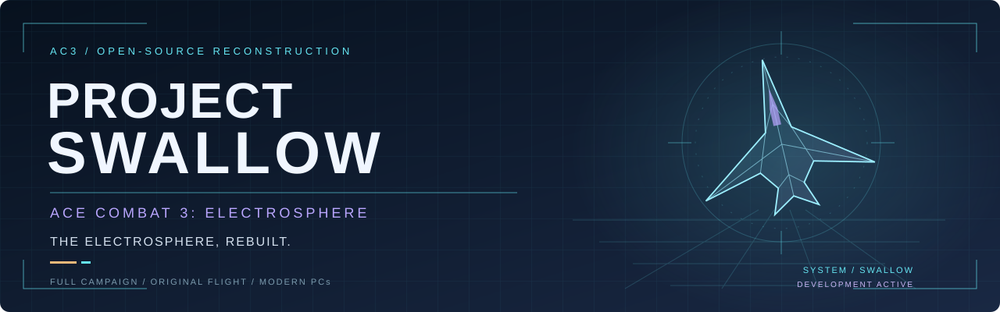

<div align="center">



**A complete, playable, open-source reconstruction of ACE COMBAT 3: ELECTROSPHERE.**

*The full Japanese campaign. The original flight model, recovered 1:1 from the game's own code. A new way into the Electrosphere.*

 [](LICENSE) · [Windows / Linux CI](https://github.com/JasonBreen/project-swallow/actions/workflows/tests.yml)

[The vision](#enter-the-electrosphere) · [Current build](#development-status) · [Get started](#run-the-toolchain) · [Roadmap](docs/roadmap.md) · [Contribute](CONTRIBUTING.md)

</div>

## Enter the Electrosphere

Project Swallow is building **Ace Combat 3: Electrosphere as a fully playable open-source game for modern PCs**. It preserves the complete Japanese two-disc experience: the branching campaign, characters, missions, and original flight behavior.

AC3's world of corporate power, fractured loyalties, and digital identity deserves to be experienced as a complete game. Swallow aims to deliver that on Windows and Linux, with enhanced artwork, modern presentation, and an English dub performed by the project team.

The repository currently contains the disc and archive tools needed to build that game faithfully. Those tools are the present development stage and foundation of Swallow; the playable reconstruction is still planned.

## How it is built

- **Engine: C (planned).** The game runtime will be written in C. No engine code exists yet.
- **Executable recovery: MIPS assembly (planned).** The original PlayStation executable and overlays will be disassembled and documented; recovered routines will be the reference for the C runtime. This work has not started; see the [executable track](docs/next-task-executable.md).
- **Resource tooling: Python.** Disc, archive, and validation tools remain standard-library Python; Python is not the planned game runtime.
- **Original behavior:** The flight model and gameplay will be recovered from AC3's own code, not approximated with generic flight-simulator physics.
- **Evidence first.** No format field or behavior is marked as decoded until bytes, code, or emulator captures confirm it. Hypotheses and counterexamples are written down.

## Development status

**Pre-alpha · toolchain v0.6.0 · no playable build available yet.**

The game is in development. There is currently no C engine, native renderer, playable mission, recovered gameplay runtime, or completed English dub. Windows and Linux are target game platforms; current automated coverage runs the Python tools on both.

| Area | Working now | Destination |
|---|---|---|
| Source discs | Four fingerprinted references; complete archives stored with Git LFS in this private repository | Reproducible inputs for the complete Japanese campaign |
| Disc access | ISO directory inspection, raw-image hashes, bounded Form 1 reads, logical-file comparison | Reliable access to game resources |
| `ACE.BPH` | Typed index parser, explicit payload sizes, range checks, metadata reports; validated against all four references | Resource loading for the C runtime |
| `ACE.BPB` / Ulz | Nested offset-table containers walked; Namco Ulz (v0/v2) decoded in memory with exact stream accounting; other leaf formats still uninterpreted | Decoded resources for the C runtime |
| TIM metadata | PlayStation TIM image leaves validated to metadata on all four references; pixels are not yet converted or written | Original assets and enhanced presentation |
| Executable | Read-only PS-X EXE headers, hashes, RAM text ranges, and path references validated on all four disc images; MIPS recovery is [planned](docs/next-task-executable.md) | Annotated original routines: loaders, flight model, and missions |
| Streaming media | Form 2 detected and kept outside the Form 1 reader | Correct XA audio/video, timing, and interleave |
| Gameplay and campaign | Not started; original code will be the reference | Playable missions, branching routes, transitions, and saves |
| English voices | Human-performed dub planned | A complete, credited team recording |

## Run the toolchain

You need Python **3.11 or newer**. On the owner's Windows machine, **everything stays on `G:`**: the checkout, extracted discs, temporary files, and reports. Do not use the `C:` drive for this project.

The repository is private. It contains all four owner-supplied reference archives through Git LFS, about **1.67 GB compressed**. For a source-only checkout:

```powershell
Set-Location G:\
$env:GIT_LFS_SKIP_SMUDGE = "1"
git clone https://github.com/JasonBreen/project-swallow.git Project-Swallow
Remove-Item Env:\GIT_LFS_SKIP_SMUDGE
Set-Location G:\Project-Swallow
```

To retrieve the archives, run `git lfs install` and then `git lfs pull`. See the [reference-disc inventory](discs/README.md) for hashes and extraction commands. The tools read extracted raw MODE2/2352 BIN images and never modify them.

From the checkout, inspect a Japanese disc, decode its BPH index, walk one BPB entry, and report its executables:

```powershell
$env:PYTHONPATH = "src"
$env:TEMP = "G:\ProjectSwallow-data\tmp"
$env:TMP = $env:TEMP
New-Item -ItemType Directory -Force $env:TEMP | Out-Null

$disc = "G:\ProjectSwallow-data\japanese-disc1\Ace Combat 3 - Electrosphere (Japan) (Disc 1).bin"
python -m swallow_tools $disc --hash --file-hashes --json   # disc inventory and hashes
python -m swallow_tools.bph $disc --json                    # ACE.BPH index
python -m swallow_tools.bpb $disc --entry 5 --decode --tree # one ACE.BPB entry, Ulz decoded in memory
python -m swallow_tools.exe $disc                         # PS-X EXE headers and path references
python -m unittest discover -s tests -v
```

On Linux, use the same modules with `PYTHONPATH=src`. `python -m swallow_tools.compare A.bin B.bin --json` compares two images file by file. An optional `python -m pip install -e .` (in a virtual environment on your project drive) installs the `swallow-disc`, `swallow-bph`, `swallow-bpb`, `swallow-exe`, and `swallow-compare` commands.

The tests use synthetic data only. They need no discs, network, emulator, paid model, or GPU.

All reports contain metadata and hashes only; no tool writes extracted assets. Exit codes are `0` for success, `2` for input or format errors, and `3` for failed strict CUE-reference checks. Exact guarantees are in the format contracts: [BPH](docs/bph-format.md), [BPB/Ulz](docs/bpb-format.md), [TIM](docs/tim-format.md), and [PS-X EXE](docs/exe-format.md).

The executable reader resolves `BOOT` from `SYSTEM.CNF`, finds other PS-X EXEs by magic, and reports headers, hashes, text ranges, and references to files on the same disc. Form 2 files are listed and skipped. `ACE3.BIN` is a second PS-X EXE; the header and path strings do not establish runtime load order. See the [EXE contract and measurements](docs/exe-format.md).

## From archives to a playable game

1. **Disc baseline — complete.** Identify the four supplied images, preserve originals, and compare supported logical contents.
2. **BPH index — implemented.** Decode and validate the archive's entry ranges; preserve uncertain fields and publish reproducible metadata.
3. **BPB containers and Ulz compression — implemented.** Walk nested offset tables and decode Ulz versions 0 and 2 with validated stream accounting on all four references.
4. **TIM metadata — implemented.** Validate PlayStation TIM leaves to metadata; pixel conversion and remaining leaf formats are still planned.
5. **Executable/MIPS recovery — next.** Disassemble the boot EXE and `ACE3.BIN`, identify library code, and document the original loaders and gameplay routines before writing the C runtime, starting with the Ulz decompressor; see the [executable track](docs/next-task-executable.md).
6. **One complete mission in the C runtime.** Aircraft, level, recovered flight model, controls, weapons, objectives, dialogue, and results working together with runtime evidence.
7. **The full Electrosphere.** Branching campaign, disc-specific content, saves, enhanced presentation, human English dialogue, and platform validation.

The [roadmap](docs/roadmap.md) tracks these stages. Passing tests establishes tool behavior; a playable mission needs its own runtime evidence.

## Evidence, people, and provenance

The [four-image baseline](docs/disc-inventory.md), [BPH validation](docs/bph-validation.md), [BPB validation](docs/bpb-validation.md), and [machine-readable reports](docs/reports/) record what has been measured. The supplied Japanese BINs match the earlier reference hashes. The English **v0.9b3** names are upload labels, not an independent release certification.

Swallow builds on years of community preservation, translation, and format research. Special thanks go to **[Team NEMO (Project NEMO)](https://www.romhacking.net/community/1189/)**, whose English fan translation and AC3 hacking work, including esperknight's decompression research, have made the full Japanese game accessible to English-speaking players. Their full crew is credited in [CREDITS.md](CREDITS.md), along with everyone else whose work this project relies on. The banner is original project artwork inspired by AC3's interface language and contains no extracted game artwork.

Code, verified format findings, original artwork, and human-performed dialogue are welcome. See [CONTRIBUTING.md](CONTRIBUTING.md) and the [local development contract](AGENTS.md). Open the checkout in VS Code or Antigravity for the supplied tests, debug configurations, and Python settings; see the [editor setup](docs/editor-setup.md).

## License

Project Swallow's original source code, tests, documentation, and banner are **MIT-licensed**. Third-party game data and the owner-supplied disc archives keep their existing rights and are excluded from that license. Project Swallow is independent of Bandai Namco.
